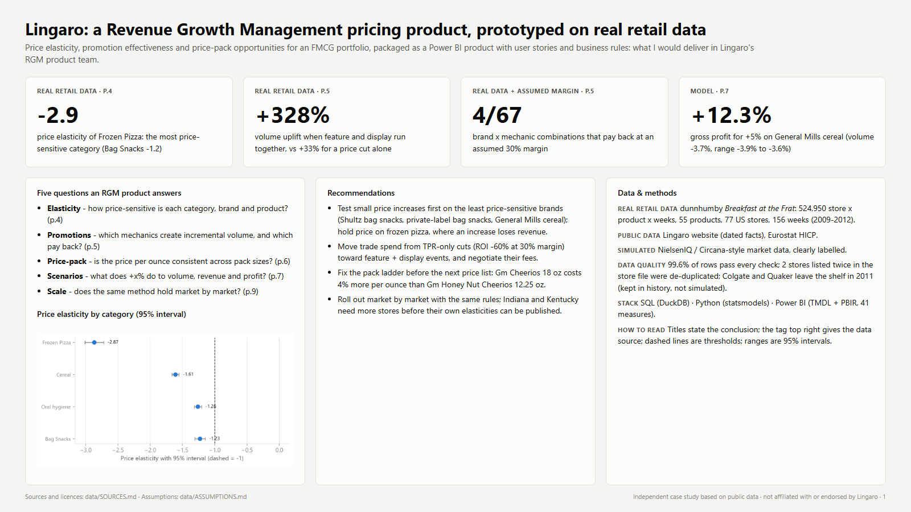

# Lingaro RGM pricing case study

A Revenue Growth Management pricing product (price elasticity, promotion effectiveness, price-pack architecture and a what-if simulator) prototyped on real retail data and packaged as a Power BI product: what I would deliver in Lingaro's RGM product team.

**Read the report: [docs/Lingaro_RGM_CaseStudy.pdf](docs/Lingaro_RGM_CaseStudy.pdf)** (11 pages, landscape)



## Key results
All four come from **real retail data** (dunnhumby *Breakfast at the Frat*: 524,950 weekly store x product rows, 77 US stores, 55 products, 2009-2012). Promotion ROI and profit figures also use an **assumed** 30% gross margin.

| | Result | Where |
|---|---|---|
| 1 | **Price sensitivity differs a lot by category and brand.** Frozen pizza: elasticity -2.9 (95% CI -3.0 to -2.7), so a price increase loses revenue. Bag snacks: -1.2. By brand, from -0.3 (Shultz pretzels) to -3.0 (King frozen pizza). | Report p.4 |
| 2 | **Feature + display lifts volume +328% vs baseline, a price cut alone +33%.** At an assumed 30% margin, only 4 of 67 brand x mechanic combinations pay back; TPR-only cuts return -60% on their discount cost. | Report p.5 |
| 3 | **+5% on General Mills cereal** (elasticity -0.78): volume -3.7% (range -3.9% to -3.6%), revenue +1.1%, gross profit +12.3% at a 30% margin. | Report p.7 |
| 4 | **The same method runs market by market.** Ohio shoppers are more price-sensitive than Texas shoppers in all 4 categories (frozen pizza -3.2 vs -2.3). Indiana and Kentucky have fewer than 5 stores, so their elasticities are not published. | Report p.9 |

Data quality findings along the way:
- 2 stores are listed twice in the store file, which would have counted their sales twice. They were de-duplicated.
- Quaker cereals and the only Colgate product leave the shelf in 2011. They are kept in the history but not simulated.
- With separate store and product effects, the bag snacks elasticity came out at -0.65, because Texas stores carry only 9 of the 15 snack products. The final model uses one effect per store x product pair instead.

## Questions this answers
| Question | Answer in this case study |
|---|---|
| How price-sensitive is each category, brand and product? | Log-log elasticity with a 95% interval. It is published only if it passes business rule BR-06 (enough rows, weeks, stores and price variation; significant and negative; a narrow interval). 72 of 78 estimates pass. The other 6 are the phased-out Quaker and Colgate lines. |
| Which promotions create incremental volume, and which pay back? | Uplift vs a baseline of clean non-promo weeks (±8 weeks). ROI = net incremental profit / discount cost, at 20, 30 and 40% margin. The week after a promotion shows no stock-up dip. Cannibalisation of other products in the category is about 0%. |
| Is the price per ounce consistent across pack sizes? | One inverted ladder: Cheerios 18 oz costs 4% more per ounce than Honey Nut Cheerios 12.25 oz. 6 products have low price sensitivity and a below-average price per ounce. |
| What does +x% do to volume, revenue and profit? | A simulator capped at ±10%, with ranges from the 95% interval. It is built in Python and as DAX what-if measures in Power BI, which are tested against each other. |
| Does the method scale to other markets? | Each US state stands in for a market. The same code, rules and report run per market, and each market is published only on its own evidence. |
| Why does pricing matter now in Europe? | EU food prices rose 35% from 2020 to 2025 (Eurostat HICP), more than all items (+26%). |

## Power BI product
`powerbi/LingaroRGM.pbip` is a Power BI project in TMDL (model) and PBIR (report) format. Every file is generated by script, so the model can be reviewed in git.

```
                Date ──┐
               Store ──┤
 Brand ── Product ─────┼──> Sales (fact: weekly store x product, with promo baseline)
          Promo Type ──┘
 Brand, Promo Type ───────> Promo Effectiveness
 Brand ───────────────────> Market Sim (SIMULATED)
 Elasticity ──────────────> Scenario Grid
 What-if parameters: Price Change (-10%..+10%), Margin Assumption (20%..45%)
```

- **Model**: 21 tables, 41 DAX measures in display folders, 9 relationships, and a `DataFolder` parameter for the data path.
- **Pages**: Overview, Price elasticity, Promotion effectiveness, Price-pack architecture, Scenario simulator, Market view (SIMULATED), One method many markets, Data quality.
- **Docs**: every measure is described in [product/MEASURES_DICTIONARY.md](product/MEASURES_DICTIONARY.md). How to open the project: [powerbi/README.md](powerbi/README.md).

## Methods
- **SQL (DuckDB)**, in `sql/`:
  - enriched sales view;
  - promotion baseline with window functions;
  - hierarchy ROLLUP;
  - price per ounce and ladder check;
  - data quality checks.
- **Python**, in `src/`:
  - Elasticity: statsmodels OLS of log(units) on log(price), with feature and display controls, store x product effects (within estimator), month effects and a trend. Errors are clustered by store.
  - Regular-price and promotion-depth elasticities; cross-price elasticity vs the rest of the category.
  - Promotion uplift, ROI, post-promotion dip and cannibalisation.
  - Scenario simulator, price-pack opportunities and a SIMULATED market feed.
- **Notebooks** (`notebooks/01-04`): a walk-through of each step on the real data. They show aggregates only.
- **Tests**:
  - 25 automated checks (`src/check_results.py`): rule unit tests, SQL vs Python reconciliations, output assertions, and the DAX logic replayed in Python;
  - a recovery test on simulated data with known elasticities: 9 of 10 true values fall inside the 95% interval, with a mean absolute error of 0.06.

**Reproduce**:
1. Install the dependencies:
   ```bash
   python -m venv .venv
   .venv/Scripts/pip install -r requirements.txt   # macOS/Linux: .venv/bin/pip
   ```
2. Run the pipeline:
   - With the real data: put the dunnhumby zip in `data/raw/retail/` (see [its README](data/raw/retail/README.md)), then run `python src/run_all.py`.
   - Without the download: run `python src/run_all.py --sample`, which uses a SIMULATED sample with the same layout.
3. Execute the notebooks: `jupyter nbconvert --to notebook --execute --inplace notebooks/*.ipynb`.

AI-assisted workflow: I used Claude, mainly to write scripts faster. I drove the project: I defined the questions, chose and validated the data sources, made the analytical decisions and checked every result.

## Product documentation
The analysis is packaged so that a development team can build on it:
- [USER_STORIES.md](product/USER_STORIES.md): 10 stories with personas and MoSCoW priorities;
- [ACCEPTANCE_CRITERIA.md](product/ACCEPTANCE_CRITERIA.md): testable Given / When / Then criteria;
- [BUSINESS_RULES.md](product/BUSINESS_RULES.md): BR-01 to BR-13, each linked to the code that implements it;
- [MEASURES_DICTIONARY.md](product/MEASURES_DICTIONARY.md): every DAX measure, its meaning, format and test;
- [TEST_PLAN.md](product/TEST_PLAN.md): automated checks, DAX vs Python, method validation.

## Data sources and licences
| Source | Label | Licence | In this repo |
|---|---|---|---|
| dunnhumby *Breakfast at the Frat* | REAL RETAIL DATA | dunnhumby Source Files terms (no redistribution) | **No raw data**: scripts and aggregated results only |
| Lingaro public website | PUBLIC DATA | Lingaro's copyright; short facts quoted with URL and date | Fact table `data/public/lingaro_facts.csv` |
| Eurostat HICP | PUBLIC DATA | CC BY 4.0 | `data/public/hicp_*.csv` |
| Market feed, test sample | SIMULATED | Generated here (seed 42) | Yes, labelled SIMULATED |

Details, collection dates and every assumption: [data/SOURCES.md](data/SOURCES.md) and [data/ASSUMPTIONS.md](data/ASSUMPTIONS.md).

## Limits
- **Elasticity is observational.** It is a correlation on historical prices set by the retailer, not a controlled test. The controls reduce confounding, but unobserved competitor moves or local events can remain.
- **The data is old and from the US** (2009-2012, one retailer). It demonstrates the method, not today's European elasticities.
- **The margin is assumed** (30%, with 20% and 40% shown). Feature and display fees are not in the data, so the ROI of those mechanics is optimistic.
- **The market data is simulated.** It shows how a NielsenIQ / Circana feed plugs in; no market conclusion is drawn from it.
- **The simulator** ignores competitor and retailer reactions and is capped at ±10% around observed prices.

---
Independent case study based on public data · not affiliated with or endorsed by Lingaro
